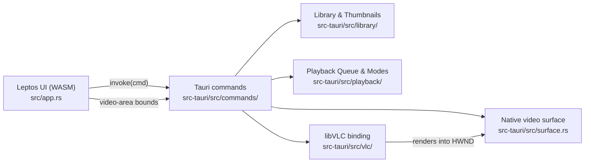

# Dotara

A desktop media player built on the **VLC engine (libVLC)** and **Tauri 2**, with a UI written entirely in Rust using **[Leptos](https://leptos.dev)** (compiled to WebAssembly — no JavaScript framework).

## Features

- **Docked Media Library Side Menu** (`☰ Library` toggle button — docked alongside the player, not a popup)
  - Supports **multiple Media Libraries** (`+ Add Library…` to add folders, clickable library chips to switch between libraries or view **All** combined, and `×` to remove a library)
  - Defaults to `E:\Songs` if present and persists all added libraries in `%LOCALAPPDATA%\Dotara\libraries.json`
  - Scrollable list of all audio and video files in the active library
  - Automatic **audio & video thumbnails** (OS video frame / album art extraction via `IShellItemImageFactory`, sidecar `.jpg`/`.png`/`.webp` matching, embedded ID3/Vorbis/MP4 cover art scanning, and SVG fallback icons)
  - **Folder Playlist & Playback Modes:**
    - **`▶ Play All`** button to play all songs inside the active folder from the beginning, and **`▶ Play Selected`** button (plus per-item checkboxes for multi-selection)
    - Playback mode selector with 4 options (**`Continue play next song in the list`** as the default, **`Play all`**, **`Selected`**, and **`Play only one song`**)
    - **`⏮` Previous** and **`⏭` Next** track buttons in the bottom control bar, plus automatic track advancement when a song finishes
  - Focusable track rows (`tabindex="0"`, Enter to play) with border-only selection focus and accent-colored text on the currently playing track (no background change); pressing any bottom transport control controls only the playing media and clears row focus
- Play / pause, stop, seek bar with elapsed / total time, and compact volume slider (hover for percentage)
- **Keyboard shortcuts:** `←` / `→` seek backward/forward by 5 seconds; `↑` / `↓` increase/decrease volume by 5%
- **Top window title bar:** shows only the app logo when idle and displays the active media name while playing
- Native single-file picker (**Open File…**)
- Video rendered by libVLC directly into a Win32 child surface inside the app window (automatically resizes when the side menu opens or closes)
- Audio tracks display their cover art thumbnail and title in the main player view

## Requirements

| Tool | Notes |
|---|---|
| Rust (MSVC toolchain) | `rustup target add wasm32-unknown-unknown` |
| [Trunk](https://trunkrs.dev) | `cargo binstall trunk` or `cargo install trunk --locked` |
| Tauri CLI v2 | `cargo install tauri-cli --version "^2"` |
| WebView2 | Preinstalled on Windows 10/11 |

No VLC SDK, headers, or external VLC installation is needed at runtime — `libvlc.dll`, `libvlccore.dll`, and playback `plugins/` are bundled directly with the app.

## Getting started

```powershell
# development (hot-reloads the UI)
cargo tauri dev

# release build + self-contained .exe installer
cargo tauri build
```

## Architecture



- **Library & thumbnails** — `library/` scans configured media folders (`E:\Songs` by default), persists `libraries.json`, and extracts thumbnails for video and audio files via Windows Shell (`IShellItemImageFactory`), sidecar images, and embedded tag artwork.
- **Playback queue & modes** — `playback/` holds pure, unit-tested `PlayMode` and `PlaybackQueue` logic separated from VLC side effects.
- **libVLC binding** — `vlc/` resolves `libvlc_*` functions from the bundled `vlc/libvlc.dll` via `libloading` and wraps them in a safe `Player` type.
- **Video surface** — `surface.rs` creates a borderless Win32 child window inside the Tauri window. Whenever the window resizes or the side menu opens/closes, the UI reports `.video-area` bounds and the native video surface resizes alongside it.
- **Commands** — `get_library`, `add_folder`, `select_folder`, `remove_folder`, `set_play_mode`, `play_all`, `play_selected`, `play_file`, `next_track`, `prev_track`, `open_file`, `play`, `pause`, `toggle_pause`, `stop`, `seek`, `set_volume`, `set_video_bounds`, `status`.

### Self-contained VLC bundle

[`scripts/prepare-vlc.ps1`](file:///e:/Software%20Projects/Music%20Player/Dotara/scripts/prepare-vlc.ps1) stages `libvlc.dll`, `libvlccore.dll`, and the playback `plugins/` (plus a freshly generated `plugins.dat` cache) into `src-tauri/vlc/`. `tauri.conf.json` bundles `src-tauri/vlc/` directly into the NSIS `.exe` installer so the installed app does not depend on an external VLC installation or search outside its own directory.

## Project layout

```
.
├── index.html, Trunk.toml               # Trunk entry point
├── styles/                              # Feature-scoped CSS (base, sidebar, media-list, player)
├── scripts/prepare-vlc.ps1              # Stages bundled VLC runtime into src-tauri/vlc
├── src/                                 # Leptos UI crate (dotara-ui, compiled to WASM)
│   ├── main.rs                          # WASM entry point
│   ├── app.rs                           # Root component & video-bounds sync
│   ├── controller.rs                    # Reactive signals and async UI actions
│   ├── api.rs                           # Typed Tauri IPC client
│   ├── models.rs                        # Shared UI structs, constants, and IPC payloads
│   ├── formatting.rs                    # Pure duration, label, active-track, and selection helpers (+ unit tests)
│   ├── shortcuts.rs                     # Global keyboard shortcuts: Left/Right seek, Up/Down volume (+ unit tests)
│   ├── tauri.rs                         # Low-level `window.__TAURI__.core.invoke` wrapper
│   └── components/                      # LibraryHeader, MediaList, VideoStage, ControlBar
└── src-tauri/                           # Tauri backend crate (dotara)
    ├── src/
    │   ├── main.rs                      # Thin binary entry point
    │   ├── lib.rs                       # App bootstrap and command registration
    │   ├── state.rs                     # Shared AppState & status/queue sync
    │   ├── surface.rs                   # Win32 child window for libVLC video output
    │   ├── vlc/                         # Runtime libVLC FFI loader (api.rs) & safe Player (player.rs)
    │   ├── playback/                    # Pure PlayMode & PlaybackQueue logic (+ unit tests)
    │   ├── library/                     # Folder models, config, scanner, and thumbnails/ (+ unit tests)
    │   └── commands/                    # Tauri IPC handlers (library.rs, playback.rs, window.rs)
    ├── examples/vlc_smoke.rs            # Headless library & libVLC check
    ├── capabilities/default.json
    ├── icons/
    └── tauri.conf.json
```

## Testing

```powershell
# Run all backend and frontend pure-logic unit tests
cargo test --workspace

# Run the headless library + libVLC smoke test
cargo run -p dotara --example vlc_smoke
```
