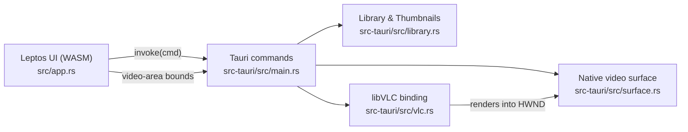

# Dotara

A desktop media player built on the **VLC engine (libVLC)** and **Tauri 2**, with a UI written entirely in Rust using **[Leptos](https://leptos.dev)** (compiled to WebAssembly — no JavaScript framework).

## Features

- **Docked Media Library Side Menu** (`☰ Library` toggle button — docked alongside the player, not a popup)
  - Supports **multiple Media Libraries** (`+ Add Library…` to add folders, clickable library chips to switch between libraries or view **All** combined, and `×` to remove a library)
  - Defaults to `E:\Songs` if present and persists all added libraries in `%LOCALAPPDATA%\Dotara\libraries.json`
  - Scrollable list of all audio and video files in the active library
  - Automatic **audio & video thumbnails** (OS video frame / album art extraction via `IShellItemImageFactory`, sidecar `.jpg`/`.png`/`.webp` matching, embedded ID3/Vorbis/MP4 cover art scanning, and SVG fallback icons)
  - **Folder Playlist & Playback Modes:**
    - **`▶ Play All`** button to play all songs inside the active folder from the beginning, and **`▶ Play Selected`** button (plus per-item checkboxes for multi-selection)
    - Playback mode selector with 4 options (**`Continue play next song in the list`** as the default, **`Play all`**, **`Selected`**, and **`Play only one song`**)
    - **`⏮` Previous** and **`⏭` Next** track buttons in the bottom control bar, plus automatic track advancement when a song finishes
- Play / pause, stop, seek bar with elapsed / total time, and volume control
- Native single-file picker (**Open File…**)
- Video rendered by libVLC directly into a Win32 child surface inside the app window (automatically resizes when the side menu opens or closes)
- Audio tracks display their cover art thumbnail and title in the main player view

## Requirements

| Tool | Notes |
|---|---|
| Rust (MSVC toolchain) | `rustup target add wasm32-unknown-unknown` |
| [Trunk](https://trunkrs.dev) | `cargo binstall trunk` or `cargo install trunk --locked` |
| Tauri CLI v2 | `cargo install tauri-cli --version "^2"` |
| WebView2 | Preinstalled on Windows 10/11 |

No VLC SDK, headers, or external VLC installation is needed at runtime — `libvlc.dll`, `libvlccore.dll`, and playback `plugins/` are bundled directly with the app.

## Getting started

```powershell
# development (hot-reloads the UI)
cargo tauri dev

# release build + self-contained .exe installer
cargo tauri build
```

## Architecture



- **Library & thumbnails** — `library.rs` scans the selected media folder (`E:\Songs` by default) and extracts thumbnails for both video and audio files using Windows Shell (`IShellItemImageFactory`), sidecar images, and embedded tag artwork.
- **libVLC binding** — `vlc.rs` resolves `libvlc_*` functions from the bundled `vlc/libvlc.dll` via `libloading` and wraps them in a safe `Player` type.
- **Video surface** — `surface.rs` creates a borderless Win32 child window inside the Tauri window. Whenever the window resizes or the side menu opens/closes, the UI reports `.video-area` bounds and the native video surface resizes alongside it.
- **Commands** — `get_library`, `pick_folder`, `play_file`, `open_file`, `play`, `pause`, `toggle_pause`, `stop`, `seek`, `set_volume`, `set_video_bounds`, `status`.

### Self-contained VLC bundle

[`scripts/prepare-vlc.ps1`](file:///e:/Software%20Projects/Music%20Player/Dotara/scripts/prepare-vlc.ps1) stages `libvlc.dll`, `libvlccore.dll`, and the playback `plugins/` (plus a freshly generated `plugins.dat` cache) into `src-tauri/vlc/`. `tauri.conf.json` bundles `src-tauri/vlc/` directly into the NSIS `.exe` installer so the installed app does not depend on an external VLC installation or search outside its own directory.

## Project layout

```
.
├── index.html, styles.css, Trunk.toml   # Trunk entry point & styling
├── scripts/prepare-vlc.ps1              # Stages bundled VLC runtime into src-tauri/vlc
├── src/                                 # Leptos UI crate (dotara-ui)
│   ├── main.rs
│   ├── app.rs
│   └── tauri.rs
└── src-tauri/                           # Tauri backend crate (dotara)
    ├── src/
    │   ├── main.rs                      # app setup + commands
    │   ├── library.rs                   # folder scanner + audio/video thumbnails
    │   ├── vlc.rs                       # libVLC binding
    │   └── surface.rs                   # Win32 video surface
    ├── examples/vlc_smoke.rs            # headless libVLC test
    ├── capabilities/default.json
    ├── icons/
    └── tauri.conf.json
```
