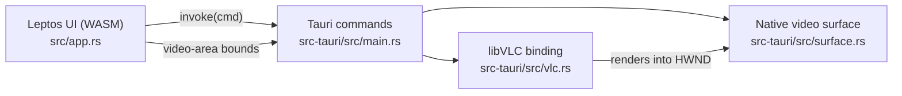

# Dotara

A desktop media player built on the **VLC engine (libVLC)** and **Tauri 2**, with a UI written entirely in Rust using **[Leptos](https://leptos.dev)** (compiled to WebAssembly — no JavaScript framework).

## Features

- Play / pause, stop
- Seek bar with elapsed / total time
- Volume control
- Native file picker (video and audio formats)
- Video rendered by libVLC directly into the app window (hardware-accelerated, any format VLC supports)
- Audio-only files show a placeholder instead of a black video area
- Auto-loads `testvideo.webm` from the project root on start (handy during development)

## Requirements

| Tool | Notes |
|---|---|
| Rust (MSVC toolchain) | `rustup target add wasm32-unknown-unknown` |
| [Trunk](https://trunkrs.dev) | `cargo binstall trunk` or `cargo install trunk --locked` |
| Tauri CLI v2 | `cargo install tauri-cli --version "^2"` |
| VLC 3.x, 64-bit | Installed at `C:\Program Files\VideoLAN\VLC`, or set `DOTARA_VLC_DIR` |
| WebView2 | Preinstalled on Windows 10/11 |

No VLC SDK, headers or import libraries are needed — `libvlc.dll` is loaded at runtime.

## Getting started

```powershell
# development (hot-reloads the UI)
cargo tauri dev

# release build + installer
cargo tauri build
```

Drop a `testvideo.webm` into the project root to have it loaded automatically, or use **Open…** to pick any file.

## Architecture



- **libVLC binding** — `vlc.rs` resolves the needed `libvlc_*` functions from `libvlc.dll` via `libloading` and wraps them in a safe `Player` type.
- **Video surface** — WebView2 cannot display libVLC output, so `surface.rs` creates a borderless Win32 child window inside the Tauri window. The UI reports the bounds of its `.video-area` element (in physical pixels) on load and on every resize, and the surface is kept on top of exactly that region. It is only shown while VLC has a video output.
- **Commands** — `open_file`, `load_default`, `play`, `pause`, `toggle_pause`, `stop`, `seek`, `set_volume`, `set_video_bounds`, `status`. The UI polls `status` every 250 ms for state, position, length and volume.
- **UI** — `src/app.rs` (Leptos components) and `src/tauri.rs` (typed `invoke` wrapper over `window.__TAURI__.core.invoke`).

### Self-contained VLC bundle

[`scripts/prepare-vlc.ps1`](file:///e:/Software%20Projects/Music%20Player/Dotara/scripts/prepare-vlc.ps1) stages `libvlc.dll`, `libvlccore.dll`, and the playback `plugins/` (plus a freshly generated `plugins.dat` cache) into `src-tauri/vlc/`. `tauri.conf.json` bundles `src-tauri/vlc/` and `testvideo.webm` directly into the NSIS `.exe` installer so the installed app does not depend on an external VLC installation or search outside its own directory.

Runtime lookup order:
1. `<exe_dir>\vlc\` (installed & release builds)
2. `<exe_dir>\`
3. `src-tauri\vlc\` (development builds)

## Project layout

```
.
├── index.html, styles.css, Trunk.toml   # Trunk entry point & styling
├── src/                                 # Leptos UI crate (dotara-ui)
│   ├── main.rs
│   ├── app.rs
│   └── tauri.rs
└── src-tauri/                           # Tauri backend crate (dotara)
    ├── src/
    │   ├── main.rs                      # app setup + commands
    │   ├── vlc.rs                       # libVLC binding
    │   └── surface.rs                   # Win32 video surface
    ├── examples/vlc_smoke.rs            # headless libVLC test
    ├── capabilities/default.json
    ├── icons/
    └── tauri.conf.json
```

## Testing libVLC without the UI

```powershell
cargo run -p dotara --example vlc_smoke -- testvideo.webm
```

Plays the file headlessly and prints state, position and length after play, pause, seek and stop.

## Limitations

- Video embedding is implemented for **Windows only** so far (Linux/macOS would use `libvlc_media_player_set_xwindow` / `set_nsobject`).
- HTML cannot be drawn on top of the video, because it is a native window. Controls live below the video area.
